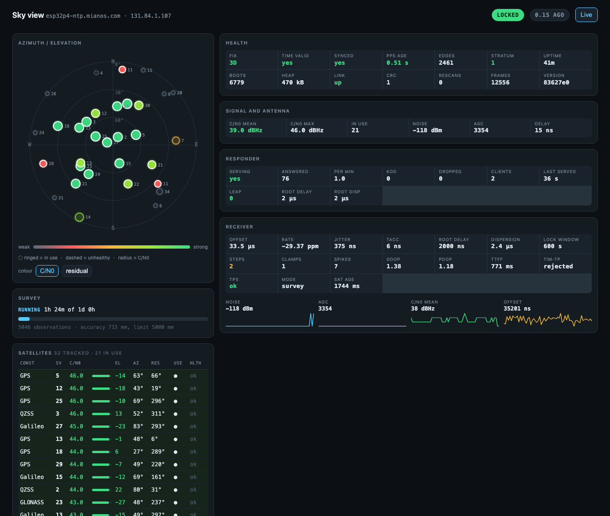

# esp32p4-ntp

A stratum-1 NTP and PTP server on an ESP32-P4. A u-blox LEA-M8T on UART1
supplies the date and time, its PPS line supplies the second boundary, and the
EMAC's IEEE 1588 counter, steered by a frequency servo, carries the time between
edges and stamps packets in hardware. The board serves NTPv3/v4 on UDP/123 over
IPv4 and IPv6, and PTP over Ethernet.

It also carries the HTTP surface of the other [mianesp](https://github.com/mianos/mianesp)
devices — `/healthz`, `/config`, OTA — and a serial console on the flashing
cable, so a box with no working network is still configurable.

Target board: **Waveshare ESP32-P4-ETH** (ESP32-P4NRW32, 32 MB flash, IP101GRI
10/100 PHY, RJ45). The P4 has an Ethernet MAC and no PHY, so the board's IP101 is
driven over RMII.

## What you need

- that board, its RJ45 on a LAN with a DHCP server, and a clear sky view
- a u-blox LEA-M8T timing module, on a carrier that brings out UART, PPS and the
  antenna connector — the firmware was written against a WD22UGRC
- **a supply on the carrier's `V_ANT` pin (pin 1)**. The board switches antenna
  power through a transistor pair; it does not generate it. Pin 2 is the module's
  own Vcc, which is separate. With nothing on pin 1 the preamp is a 10–20 dB
  attenuator: worse than a passive antenna, not better.
- an active GNSS antenna. A passive one works and sees less.
- a USB-C cable, for the first flash and for the console

No RTC, no display, no button. `timeSource=dhcp` or `static` runs without a
receiver at all, as a stratum-3 server.

## Wiring

Ethernet is the board's own RJ45 through its own PHY, so there is nothing to
wire: plug it in. The RMII pins are fixed in the `kEthPins` table at the top of
`main/net/eth_link.cpp`:

| Signal      | GPIO | Notes                     |
|-------------|------|---------------------------|
| MDC         | 31   | SMI clock                 |
| MDIO        | 52   | SMI data                  |
| PHY nRST    | 51   | active low                |
| RMII REF_CLK| 50   | 50 MHz input from the PHY |
| RMII TX_EN  | 49   |                           |
| RMII TXD0   | 34   |                           |
| RMII TXD1   | 35   |                           |
| RMII RXD0   | 29   |                           |
| RMII RXD1   | 30   |                           |
| RMII CRS_DV | 28   |                           |

PHY address 1, the IP101 default. If you swap boards, that table is the only
thing to change.

The receiver goes on UART1 and one interrupt pin. These are `kTxPin`, `kRxPin`
and `kPpsPin` at the top of `main/gps/gps_internal.h`:

| Module pin | GPIO | Direction | Carries |
|---|---|---|---|
| TX  | 16 | into the P4  | `NAV-PVT` and `NAV-TIMELS` once a second: UTC date and time, fix, satellites, leap offset |
| RX  | 15 | out of the P4 | configuration frames at boot |
| PPS | 14 | into the P4, rising edge | the top of the second |

The UART says *which* second it is; the PPS says *when* that second started.
Neither alone is a clock: a NAV-PVT frame lands tens of milliseconds after the
boundary, and the edge carries no date. They are paired — a frame within 900 ms
of an unpaired edge becomes an anchor — and every timestamp served is that anchor
plus the time elapsed on the 1588 counter, not the system clock, so an
`adjtime()` in flight never reaches a reply.

The module's timepulse is asserted at every boot: 1 Hz, `alignToTow`, rising
edge, UTC grid, 100 ms wide, so a pulse changed in `u-center` is put back.
`/healthz` reports a refusal as `gps_tp5_rejected`.

## Build and flash

ESP-IDF v6 with the `esp32p4` target. `build.sh` uses `$IDF_PATH` if it is set
and otherwise `~/.espressif/v6.0.1/esp-idf`:

```sh
./build.sh            # build
./build.sh flash      # build + flash over USB
./build.sh monitor    # build + flash + serial log (Ctrl-] to quit)
./build.sh erase      # erase the whole flash
```

`PORT=` picks the serial node if the guess is wrong. On macOS use the
`/dev/cu.*` node: `/dev/tty.*` intermittently reports `EBUSY`.

The first build fetches the mianesp components over git, so it needs an SSH key
with read access to `mianos/mianesp`. They land in `managed_components/`, which
is git-ignored and cached after the first build; `espressif/cjson` comes from the
component registry and needs network once.

`sdkconfig.defaults` holds the required options — lwIP SNTP/DHCP-option-42,
IPv6/SLAAC, and the two-OTA partition table (`nvs`, `otadata`, `phy_init`,
two 1700 K app slots). It only seeds a *fresh* `sdkconfig`; after pulling a
change like that, `rm sdkconfig` or run `idf.py menuconfig` before building.
`nvs` sits at the same offset in both partition tables, so settings survive.

USB is only needed the first time, or to recover. After that, updates go over the
network — see [Updating over the network](#updating-over-the-network).

### Host tests

`test/` holds the tests that need no board. They put `main/` on the include path
and call the firmware's own functions — not a twin of them — so a rule is tested
where the firmware keeps it.

```sh
./test/run.sh
```

`leap_test.cpp` walks the leap path end to end: the UBX-NAV-TIMELS payload and
its two independent valid bits, RFC 5905's last-minute window, what a reply says
when the source is unlocked or the answer is a kiss-o'-death, the octet that
carries the indicator, and the TAI-UTC offset PTP announces. 2026 has no leap
pending, so the steady state is the case that runs for years and the rest would
otherwise never run at all.

`phcslew_test.cpp` runs the loop that walks the 1588 counter's phase onto the
PPS edge: that a 10 µs phase (and the ~29 µs the counter starts out with) falls
inside the deadband without overshooting, that a drifting crystal parks it where
the bias equals the drift rather than oscillating, and that the rate excursion
stays inside the 20 ppm cap a PTP slave can follow. A sign error here would push
served time away from the edge instead of onto it.

## First boot

The console is UART0, which on this board is the USB-C port's CH343 bridge: the
cable that flashes it is the shell on it. `idf.py monitor` opens both.

A healthy boot looks like this (addresses and MAC are placeholders; the box
prints its own):

```
I (385) eth_demo: esp32p4-ntp: RMII + IP101, DHCP client, HTTP /healthz, NTP from GPS/PPS or upstream
I (395) settings: hostname=esp32p4-ntp tz=AEST-10AEDT,M10.1.0,M4.1.0/3 timeSource=gps ntpServer=(unset) serveNtp=on
I (395) gps_time: UART1 38400 8N1 (esp TX 15 -> module RX, esp RX 16 <- module TX), PPS on GPIO14
I (585) gps_time: UBX frames arriving at 38400 baud
I (585) gps_time: module accepted the 1 Hz message set
I (705) gps_time: 3D fix, 18 satellites, UTC 2026-11-13T12:17:19+1100 (nano 495480)
I (705) gps_time: clock set from the GPS (2026-11-13T12:17:19+1100)
I (955) eth_demo: MDIO addr 1: PHY ID 0x02430c54 (IP101 = 0x0243xxxx)
I (1405) gps_time: locked: stratum 1 from here on (PPS edges so far: 1, rate +0 ppb)
I (2965) eth_demo: link up   (MAC 02:00:5e:00:53:01)
I (4395) eth_demo: IPv6 link-local: fe80::200:5eff:fe00:5301
I (7395) eth_demo: IPv6 global: 2001:db8::20
I (7465) eth_demo: DHCP lease: ip 192.0.2.20  mask 255.255.255.0  gw 192.0.2.1
I (7475) WebServer: Starting server on port: 80
I (7535) ntp_server: serving on udp/123 (dual-stack), reference: GPS/PPS, 3D fix, 18 satellites, stratum 1
```

The clock is set before the network is up, so the responder is already stratum
1 when the lease arrives. `rate +0 ppb` is expected: a rate needs a minute of
anchors.

The address the lease prints is the one to use. `curl http://<box>/healthz` and
`ping` should both answer; `<box>` is that address in every example below. A ping
reply proves the whole path — PHY, RMII clocking, DHCP, lwIP, ICMP.

IPv6 comes up beside IPv4 with no configuration: a `fe80::` link-local at
link-up, and a global address from the router's advertisements. See
[IPv6](#ipv6).

There is no RTC, so until something sets it the clock reads 1970 plus uptime;
`/healthz` reports `time_set` to say which.

## Console

Log stream by default: every line, no prompt, and commands still run. `console on`
is the debug state — prompt, log silenced — and `console off` puts it back.
Commands work in both. Nothing is persisted, so a reboot comes back logging.

Raw, without `idf.py` (the reader expects CR):

```console
$ stty -F /dev/ttyACM0 115200 raw -echo -hupcl
$ printf 'status\r' > /dev/ttyACM0
```

The console covers what the HTTP API does, for when the network is the fault.
Settings go through the same validation as `POST /config`, and actions use the
same functions as the HTTP handlers.

The console is unauthenticated, and `config` prints the whole blob — there are no
secrets in it.

**Addressing** — prints what it did and the new state.

| Command | Effect |
|---|---|
| `net` | show mode, address, gateway, resolver, link |
| `net static <cidr> <gw> [dns]` | set a static address, persist and apply live |
| `net dhcp` | back to the DHCP client |
| `eth` | link state, MAC restart count, addressing |
| `eth restart` | restart the MAC; the recovery for a wedged link |

**State** — read-only, and only what `/healthz` already publishes.

| Command | Effect |
|---|---|
| `status` | one screen: version, uptime, link, addressing, IPv6, fix, mode, owner, stratum, dispersion |

**Service**

| Command | Effect |
|---|---|
| `serve <on\|off>` | answer UDP/123 |
| `timesource <off\|dhcp\|static\|gps\|auto>` | where the clock comes from |
| `ntpserver [host]` | upstream for `timeSource=static` |
| `hostname [name]` | DHCP hostname |
| `log [<ip> <port>]` | UDP log sink |
| `console on` / `console off` | prompt and silence, or back to the log stream |

**Config**

| Command | Effect |
|---|---|
| `config` | print the stored config, pretty (`config raw` for one line) |
| `config set <key> <value>` | any key from [Configuration](#configuration) |
| `config reset` | compiled-in defaults; the boot count survives |

**Receiver**

| Command | Effect |
|---|---|
| `gps` | fix, satellites, survey progress, mode |
| `gps survey stop` | back to a moving position; the held position is kept in NVS for `fix` |
| `gps survey fix` | lock the held position: the survey's mean while that is still in RAM, otherwise the record in NVS |
| `gps reset [soft\|hard\|power\|cold]` | reset the receiver; `hard` re-initialises the front end, `cold` also drops the almanac |
| `gps ant <on\|off>` | antenna bias, for swapping an antenna under the same settings |
| `gps gnss <hex>` | constellation mask, `1`..`ff` |
| `gps suppress <s>` | ignore PPS edges for `s` seconds — a deliberate holdover, `0` to stop |
| `gps defaults` | clear the receiver's configuration to its own defaults |

**Board and NVS** — IDF's own commands.

| Command | Effect |
|---|---|
| `help [cmd]`, `version`, `restart`, `free`, `heap`, `tasks` | usage, build, reboot, memory, task list with each task's core |
| `log_level <level> [tag]` | log level, all tags or one; `log_level debug tx_lag` (or `ntp_server`, `ptp`, `gps_time`) shows the periodic diagnostics |
| `nvs_namespace`, `nvs_list`, `nvs_get`, `nvs_set`, `nvs_erase`, `nvs_erase_namespace` | read and write the NVS partition directly |

Not on the console, deliberately: firmware upload (an upload needs the network it
is delivered over, and a serial reflash is the fallback anyway) and static IPv6
(SLAAC only). `config reset` clears `gpsFixedPos`, `antDelayNs` and
`gpsUserDelayNs` with everything else, so record them before a reset.

## Configuration

`/config` takes and returns a flat JSON object. Values are strings; unknown keys
are ignored so an older or newer client will not break it. Everything is stored
in NVS and survives a reboot.

| Key | Default | Effect |
|---|---|---|
| `hostname` | `esp32p4-ntp` | netif hostname and DHCP option 12. 32 characters max; a change reaches the lease at the next renewal. |
| `tz` | `AEST-10AEDT,M10.1.0,M4.1.0/3` | POSIX TZ for `localtime()`. Presentation only — NTP always serves UTC. |
| `timeSource` | `dhcp` | `dhcp` takes the server from DHCP option 42, `static` polls `ntpServer`, `gps` disciplines from the receiver, `auto` is `gps` with the upstream behind it, `off` leaves the clock alone. Unknown values are treated as `off` and logged. |
| `ntpServer` | *(empty)* | Upstream host or address for `static`, and preferred over option 42 under `auto`. A hostname is resolved through the lease's DNS. An IPv6 literal is stored but cannot sync. |
| `ptpMode` | `off` | `off`, `master` or `slave` ([PTP](#ptp)). |
| `ptpDomain` | `0` | PTP domain, 0..127. |
| `ptpPriority1` | `128` | priority1 the Announce carries, 0..255. |
| `serveNtp` | `on` | `off` stops the responder within a second, `on` restarts it, no reboot. Serving an unlocked clock is safe: it answers stratum 16 with LI 3. |
| `ipMode` | `dhcp` | `static` programs the three keys below instead of taking a lease. |
| `ipAddress` | *(empty)* | `a.b.c.d/len`, len 1..30. Programmed only in `static` mode. |
| `ipGateway` | *(empty)* | Optional even in `static` mode: a box with an address and no route is still on the wire. |
| `ipDns` | *(empty)* | Optional; empty clears the resolver. |
| `gpsTimeMode` | `moving` | `moving`, `survey` or `fixed`. Prefer `POST /gps/survey`, which sets this with the parameters. |
| `gpsFixedPos` | *(empty)* | `x,y,z,acc_mm[,validated]` in centimetres and millimetres, for a surveyed or known antenna position. An accuracy above 60000 is read as a legacy variance (mm^2) and square-rooted. Re-sent at every boot. |
| `gpsSurvey` | *(empty)* | `hours,acc_mm`, hours 2..48, acc_mm 50..60000. Read when a survey is armed from NVS. |
| `antDelayNs` | `0` | Antenna lead delay in ns, up to 200000. Brings the pulse forward by the cable's delay. |
| `gpsUserDelayNs` | `0` | Calibration term in ns, ±10 ms, kept separate from the lead so a measured correction stays distinguishable from a cable length. |
| `gpsBaud` | `38400` | Written by the firmware when frames arrive at a new rate. Set by hand only if the stored value is wrong. |
| `logHost` / `logPort` | *(empty)* / `5514` | UDP log sink, a dotted quad. `""` clears it. |
| `boots` | `0` | Read-only boot counter. |

```console
$ curl -s -X POST -H 'Content-Type: application/json' \
       -d '{"hostname":"p4-ntp","tz":"UTC0"}' http://<box>/config
$ curl -s -X POST http://<box>/config/reset
```

Body size is capped at 4 KB and string values at 63 characters; longer values are
truncated and logged. Nothing is authenticated — anything on the LAN can
reconfigure the box.

## HTTP API

Success is a 2xx with the resulting state as the body; failure is
`{"error":"...","statusCode":N}` with the matching status, and unknown paths and
wrong methods get the same JSON shape.

| Method | Path | Purpose |
|---|---|---|
| GET | `/healthz` | uptime, clock, build, heap, link, addresses, clock source, servo, responder |
| GET | `/config` | current settings |
| POST | `/config` | apply any subset of the keys, persist, echo back |
| POST | `/config/reset` | compiled-in defaults |
| POST | `/ntp/sync` | poll the upstream now and wait up to 5 s; while the receiver serves, report the lock |
| POST | `/ntp/txlag` | transmit correction on or off, for A/B runs |
| GET | `/gps/info` | receiver identity, servo, signal, antenna, configuration answers |
| GET | `/gps/bench` | all of the above plus the configuration echoes, for a bench session |
| GET | `/gps/sats` | per-satellite C/N0, elevation and azimuth |
| GET | `/gps/samples` | drain the 900-epoch ring by cursor |
| POST | `/gps/survey` | `{"action":"start","hours":24,"acc_mm":30000}`, `{"action":"fix"}`, `{"action":"stop"}` |
| POST | `/gps/pps` | ignore PPS edges for `{"suppress_s":N}` seconds — the holdover test hook |
| POST | `/gps/ant` | `{"bias":"on"\|"off"}`, `{"delay_ns":N}` cable delay, `{"user_ns":N}` calibration, `{"pulse_ms":N}`, `{"period_us":N}` |
| POST | `/gps/gnss` | `{"set":"max"\|"beidou"}` or `{"mask":N}` |
| POST | `/gps/reset` | hot start; `{"cold":true}` also drops the almanac; `{"hardware":true}` re-initialises the receiver |
| POST | `/gps/baud` | `{"baud":38400,"module":true}` |
| POST | `/eth/restart` | restart the MAC |
| POST | `/config` `ptpMode`/`ptpDomain`/`ptpPriority1` | PTP, see [PTP](#ptp) |
| GET | `/firmware` | build and slot information |
| POST | `/firmware` | write the body into the inactive slot and reboot into it |

`/healthz` reports `ptp_mode`, and while PTP is on the domain and its counters:
`ptp_sync_sent`, `ptp_announce_sent`, `ptp_delay_resp`, `ptp_frames`,
`ptp_last_peer`, plus `ptp_offset_ns` and `ptp_slave_measured` as a slave.

`/healthz` reports the clock source, the responder's live claim, the receiver's
fix and the servo, and the hardware stamp path: `phc` (the 1588 counter is
running), `hw_rx_stamps`, `hw_tx_stamps` and `hw_tx_missing` — a zero that is not
moving is the answer. Some fields are present only when they apply, because a
healthy box has nothing to say about them: `gps_tp5_rejected`,
`gps_ant_cfg_rejected`, `gps_ant_short`, `gps_ant_latched`,
`gps_pps_suppressed_s`. Address fields are omitted until each address exists.

`ip` is the board's, not the caller's: the same JSON comes back over either
family.

## GPS reference

`timeSource=gps` makes the box a stratum-1 server. `auto` adds an upstream behind
it ([fallback](#fallback)).

The receiver is configured at every boot with `UBX-CFG-MSG`: `NAV-PVT` and
`NAV-TIMELS` once a second, all NMEA off. Each message is sent on its own and
waits for its own ACK or NAK, because this module answers some messages and
ignores others. Only the port (IO) settings are saved to the receiver's flash.

The line starts at the rate in `gpsBaud`, 38400 as shipped. With no valid frame
in 4 s it walks 9600, 115200, 57600, 19200 and 4800 and then starts over.
38400 keeps the line about 10% busy with the diagnostics enabled, against 43% at
9600. `POST /gps/baud {"baud":38400,"module":true}` moves
it; without `module` only the host moves.

If a whole pass hears nothing, a reset is sent at every rate, at most once a
minute, and the scan resumes at 9600.

Only the receiver's IO section is saved to its flash, so a new rate survives a
power cut without pinning the message rates and the constellation mask to that
boot. The module does not resume its periodic output until it is power-cycled,
so the old rate is written back if frames stop; and it never ACKs `CFG-PRT`, so
silence means carry on and only a NAK stops the move.

### Constellations

`UBX-CFG-GNSS` is asserted at every boot: **GPS + Galileo + GLONASS + QZSS**.
SBAS and IMES are off — nothing here applies SBAS corrections and IMES is an
indoors system.

**BeiDou and GLONASS are mutually exclusive on this receiver.** Enabling BeiDou
is NAKed while either GLONASS or Galileo is on, so two coherent sets exist:

| `POST /gps/gnss` | Set |
|---|---|
| `{"set":"max"}` (default) | GPS, Galileo, GLONASS, QZSS |
| `{"set":"beidou"}` | GPS, BeiDou, QZSS — trades GLONASS and Galileo |

`{"mask":N}` takes one bit per `gnssId` (GPS 0, SBAS 1, Galileo 2, BeiDou 3,
IMES 4, QZSS 5, GLONASS 6). A refused mask leaves the old set in place and
reports `gnss_cfg` as `rejected`.

A new constellation takes minutes to appear: Galileo took about seven minutes
here, and ten to fill out.

### Surveying the position

A timing receiver should not be solving its own position. While it does, the
position wanders with the clock and the pulse with it; with the position fixed it
solves time only.

```console
$ curl -s -X POST -d '{"action":"start"}' http://<box>/gps/survey
$ curl -s http://<box>/gps/info | grep svin          # watch it
$ curl -s -X POST -d '{"action":"fix"}' http://<box>/gps/survey
```

The defaults are 24 hours and a 30 m limit. The receiver ends a survey only when
the minimum duration **and** the mean variance limit are both met, and the limit
is compared with the site's scatter, so a limit below it never finishes. Pick it
from `gps_svin_acc_mm` while the survey runs; 30 m works here, 3 m never did.

A finished survey is logged with its accuracy, not held automatically. Changing the mode mid-survey
does not restart it; `stop` then `start` does.

`fix` locks what it has: the survey's mean while that is still in RAM, and
otherwise the record in NVS, so it also works after a reboot and after `stop`.
An older record stored the survey variance where the accuracy goes; that is
converted on the way in and rewritten in mm. `stop` leaves the record alone, so
the position outlives a move back to a moving position and `fix` can restore it.

The mode and position are re-sent from NVS at boot. `CFG-TMODE2` restarts the
pulse generator, so it is not sent until there is a fix, satellites and a live
edge, and a refusal after that backs off from 5 s to 5 min.

### Antennas

The M8T does have an antenna supervisor, and `CFG-ANT` bit 2
(open-circuit detection) is the one this firmware rejects: `0x0F` is NAKed,
`0x0B` with the pins named is accepted. A NAK is about the whole message, so any
one unsupported bit hides an otherwise complete feature.

With the bias on, `agc` falls from about 5300 to the low hundreds and `cn0_max`
goes from 0 to 42–44. Compare antennas by C/N0, not satellite count.

Turning the bias off and on again does not bring the sky back by itself — the
receiver sits at zero satellites until it re-initialises its front end, so
`/gps/ant` queues a reset on the off-to-on edge.

The RF connector is SMB. An SMA adapter on it is a snap-fit with real loss and
contact risk: reseat it before blaming the antenna.

A known lead delay goes in as `{"delay_ns":N}`; coax is about 5 ns per metre.

### `/gps/info` and `/gps/sats`

`/gps/info` is the polled subset of the receiver diagnostics; `/gps/bench` has
all of them. `ant_cfg` and `timtp` are `rejected`, `accepted` or `silent`.

| Key | Means |
|---|---|
| `cn0_max` / `cn0_mean` / `cn0_used` | C/N0 on used satellites, dBHz. How two antennas are compared. |
| `agc` | AGC count. Pinned near 5460 is a desensed front end: no preamp, an open feed, or an interferer. |
| `jam_ind` / `jam` | Interference index and verdict. High alongside *low* `agc` means an interferer rather than a missing feed. |
| `noise_dbm` | `MON-HW` noise floor. Barely moves here; `agc` and `cn0` are the tell. |
| `ant` / `ant_power` / `ant_bias` | What the supervisor reports and what the switch is doing. |

`/gps/sats` is C/N0 with elevation and azimuth per satellite, for a polar plot;
C/N0 against elevation separates a reflection from a low satellite. `flags` is
the receiver's own word: `svUsed` bit 3, `health` bits 4–5. `elev` is `-91`
before a fix.

### u-center, at the same time as the server

`u-center` can be attached to TCP port 3333 while the box serves time. While a
client is attached it is the only writer; the bridge reads the UART and feeds
the same parser the clock uses, and the firmware sends no configuration of its
own. `MON-COMMS` is answered locally, because this module ignores the poll that
`u-center` opens with.

Four clients at once, and a fifth is refused with `bridge_refused` set. There is
no authentication on the port.

`tools/mon_comms_probe.py` and `tools/poll_matrix.py` speak to it the same way;
see `docs/ubx.md`.

### Lock, holdover, and what a client sees

| State | LI | stratum | refid | A client does |
|---|---|---|---|---|
| fix ≥ 2D, valid time, edge inside the window | 0 (1 or 2 in the minute before a leap) | 1 | `GPS` | trusts it |
| fix and a measured rate, edge older than 10 min | 3 | 16 | `INIT` | discards it |
| no rate yet, and no fix / no edge / edge over 3 s old | 3 | 16 | `INIT` | discards it |

Before the crystal's rate is known (sixty anchors, a minute) three missed edges
demote the server. After that the lock window is ten minutes, with root
dispersion growing 1 µs per second from about 43 µs at the edge. Replies are
also demoted once dispersion passes 400 µs, which by that arithmetic is about six
minutes into a holdover, before the ten-minute window ends (worked out from the
code, not measured).

The first anchor after a gap logs the gap and the error, and `/healthz` keeps
`gps_last_holdover_s` and `gps_last_holdover_error_us`.

`POST /gps/pps {"suppress_s":150}` tests it (capped at an hour), through the same
code path a loose wire takes:

```console
$ curl -s http://<box>/healthz | tr ',' '\n' | grep holdover
"gps_last_holdover_s":150.9955
"gps_last_holdover_error_us":-2.032
```

While a test is armed, `gps_pps_suppressed_s` is present.

### The servo

Every anchor is one sample of the mono counter against the GPS, and a
least-squares fit over the last five minutes gives the crystal's rate error in
ppb: about −30 ppm on this board, wandering with temperature. Negative means
the counter runs slow. The mono counter is the systimer `esp_timer` is built on,
read at its own 16 MHz (62.5 ns) rather than in `esp_timer`'s whole
microseconds: the same epoch and the same crystal, seen a step finer.

The rate is pushed into the 1588 counter (`esp_eth_mac_adj_ptp_time()`), so the
counter that served time and PTP stamps come from runs at GPS rate, and a
holdover error is the fit's residual rather than rate times gap: 2 µs across
151 s rather than 4.5 ms. The counter's phase against the PPS edge is walked out
with a rate bias of up to 20 ppm on top of the fitted rate (`phc_slew_ppb`,
`phc_phase_ns`), so its second boundary moves onto the edge smoothly instead of
jumping. A step of up to 10 µs every hour or two was a discontinuity in served
time and in every stamp PTP carries, and it left the ~20 µs read-to-set gap
behind as a landing error to be learned; only a phase beyond 1 ms is stepped now
(`phc_steps`), since slewing that takes minutes. `CLOCK_REALTIME`, used for logs
and HTTP, is slewed with `adjtime()`.

Two numbers describe the tie, and they are not the same thing. `tie_rms_ns` and
`tie_max_ns` are the RMS and worst residual of the five-minute fit, which is
what dispersion is built from: over five minutes the crystal's own wander (a few
ppb is a few hundred ns of sag across the window) counts as much as the stamping
does, so the figure moves with temperature and is not a per-edge measurement. The
sample ring's `jitterNs` is one edge against the fit as it stood at that edge:
20–90 ns here, against 24–500 ns for the window figure. Quote the ring when the
question is a single edge's tie.

### Accuracy, and the parts that are not

- The edge is stamped in the interrupt handler, with the variable part of the
  interrupt latency measured and removed (below). The stamp itself is the
  systimer's count, 62.5 ns, not `esp_timer`'s microseconds: reading the same
  counter a step finer took the fit residual from about 293 ns rms and 568 ns
  max, which is what uniform truncation to a microsecond predicts, to 48–72 ns
  rms and 139–176 ns max over four windows (2026-11-23).
- That interrupt has core 1 to itself. Every task, and so every other driver
  interrupt, is on core 0, so a masked stretch in the network stack or the heap
  cannot hold the edge off. IDF's tick, idle task and flash-write parking still
  run on core 1. `tasks` and `intr` on the console show who is where.
- A GPTimer capture, latched by the edge through the ETM, is read beside each
  clock read in the handler. The fixed path to the systimer stamp
  (`pps_stamp_floor_ns`, about 2.7 µs) is absorbed by the fit; the excess over it
  is subtracted from the stamps, and an edge whose clock read was itself stalled
  is dropped (`pps_latency_dropped`). The 1588 counter is reached over MDIO:
  `pps_phc_floor_ns` is about 4.6 µs and the read about 0.9 µs, so the whole
  handler floors at `pps_latency_min_ns`, about 7.4 µs.
  Late edges, 4–7 µs over the floor, landed within 0.2–1.2 µs of the fit with
  this, against 3–10 µs without it.
- Between edges the anchor is extended on the rate-steered 1588 counter.
- The arrival stamp is hardware. The EMAC's 1588 counter stamps the frame as the
  DMA receives it, so neither the scheduler nor the stack is in it, and the reply
  carries that instant. The served time is computed from the same counter, so the
  two need no conversion.
- The transmit stamp *in the packet* is still software: it has to be written
  before the frame leaves, and this unit cannot insert a timestamp into a frame it
  is sending (one-step). The *measured* transmit stamp is kept and used, which is
  what an interleaved client is answered with.
- Leap seconds come from the receiver, not from a constant. `NAV-TIMELS` carries
  the GPS-UTC offset, and an announced leap sets LI in the last minute before it.
  The indicator is gated on the change type *and* the countdown, because the
  module reports a non-zero countdown even with nothing announced. Unlocked, LI
  is 3.
- Root delay is 0 (a local reference). Root dispersion is about 43 µs at the
  edge: a 2 µs latency allowance, half the receiver's quantisation error, the fit
  jitter, and a term measured from clients' timestamps (at least 40 µs). It grows
  1 µs per second of holdover. `/healthz` carries both before 16.16 rounding.

## Serving NTP

`NtpServer` answers on UDP/123 from one dual-stack socket
(`AF_INET6`, `IPV6_V6ONLY=0`, bound to `::`), started on the first lease beside
the HTTP server. It serves whichever source set the clock: stratum 1 from the
GPS, stratum 3 from the upstream.

| State | LI | stratum | refid |
|---|---|---|---|
| GPS locked | 0, or 1/2 in the minute before a leap | 1 | `GPS` |
| upstream locked, synced under 15 min ago | 0 | 3 | the upstream's address |
| not locked | 3 | 16 | `INIT` |
| over the rate limit | 0 | 0 | `RATE` |

Stratum 3, not 2, because lwIP's SNTP client does not keep the upstream's own
stratum: this device cannot know whether it is one or two hops from the
reference, and under-claiming is the safe error.

On the wire:

- **Answers mode 3 only, version 3 or 4, and replies in the request's version.**
  A mode 4 packet (another server), mode 1, version 2, or anything under 48
  bytes gets silence.
- **Always 48 bytes out, never more than came in.** No MAC, no extension fields
  echoed.
- **Replies go out as raw frames**, built here, so the transmit stamp comes from
  the MAC rather than from a read after `sendto()`. The destination MAC is the one
  the request arrived from, so no ARP or NDP lookup stands between the stamp and
  the wire.
- **Origin timestamp is the client's transmit field byte for byte**, including an
  all-zero one.
- **Precision −20**, about 1 µs.
- **refid** is the upstream's IPv4 address at stratum 3, or a stable FNV-1a of
  the name when the upstream is a hostname (lwIP does not expose the resolved
  bytes for RFC 5905's MD5). At stratum 1 it is `"GPS\0"`.
- **Rate limit**: a 16-packet burst per source address (a few `sntp` runs), then
  one request per 2 s, then one `RATE` kiss-o'-death per second, then silence.
  Eight addresses are remembered.
- **Log**: one line at start-up and one for the first request; the per-minute
  counts are at debug level.

Not included: NTS and broadcast/multicast.

### Interleaved mode (RFC 9769)

An interleaved request carries the previous reply's receive timestamp as its
origin, and the reply carries that exchange's transmit timestamp as the MAC
measured it. Use it: a basic reply's transmit field is written before the frame
leaves, and on a test client that showed as an 85 µs bias that `xleave` removed.

Replies that fall back to `sendto()` (no hardware transmit stamp) have their
transmit stamp moved later by `ntp_tx_lag_us`, the median duration of a
`sendto()` to the device's own address, probed every 5 s. It is a lower bound,
since the driver and wire come after the call. `ntp_tx_corrected` counts the
replies it was added to: 0 while every frame gets a hardware stamp, which is
the case on this board. `POST /ntp/txlag {"enabled":false}` turns it off.

The saved-pair table is 24 entries, keyed by address, dropped after two minutes.
A client further behind than that gets a basic reply.

### Control queries (`ntpq`)

The same socket answers read-only mode 6 ([RFC 9327](https://www.rfc-editor.org/rfc/rfc9327.html)):
`READSTAT`, `READVAR`, `READCLOCK`. `WRITEVAR` is refused rather than
half-applied, because a write would only duplicate `POST /config`.

```console
$ ntpq -p <box>
     remote           refid      st t when poll reach   delay   offset   jitter
==============================================================================
*GPS(0)          .GPS.            1 l    -   16  1567   0.0520   0.0146   0.0004
```

One association. An unlocked clock clears its reach bit and shows as
unreachable with stratum 16.

### Testing it

```console
$ sntp <box>                      # macOS, BSD, Linux (ntp package)
+0.114044 +/- 0.002362 <box> <box>
$ chronyd -Q 'server <box> iburst'    # as root
```

`docs/chrony.conf.example` is a client config for chrony: it names the box,
uses `xleave`, leaves `prefer` off so a bad answer can be outvoted, and keeps
internet sources below it.

`tools/ntp_test.py <ip> [ipv6]` answers what is actually on the wire, including
packets a real client never sends: mode 4 / mode 1 / vn 2 / truncated requests
that must get silence, the origin echo, IPv6, and a burst that trips the limiter.

On `/healthz`, `ntp_requests` climbs by one per answered packet (not KoDs or
drops). If it climbs and the client still fails, look at the client.

With `timeSource=off`, `sntp` should say
`Server not synchronized` while `/healthz` says `ntp_stratum: 16`.

## PTP

`ptpMode` makes the box speak IEEE 1588 on the same wire, from the same counter.
`master` announces it and sends Sync / Follow_Up; `slave` follows an announced
master and reports the offset. Off by default.

| `POST /config` | |
|---|---|
| `"ptpMode":"master"` | announce, Sync every second, answer Delay_Req |
| `"ptpMode":"slave"` | follow one master, send Delay_Req, report the offset |
| `"ptpDomain":0..127` | domain, default 0 |
| `"ptpPriority1":0..255` | the priority1 an Announce carries, default 128 |

The console has `ptp [off|master|slave]` and prints the counters with no argument.

To check it from a Linux host on the same segment (linuxptp; `-2` because the
box speaks PTP over Ethernet, not UDP; hardware stamps need a NIC with a PHC):

```console
# ptp4l -2 -s -i eth0 -m             # slave only; watch "master offset" settle
# pmc -u -b 0 'GET CURRENT_DATA_SET' # ask that local ptp4l, over its socket
# phc_ctl /dev/ptp0 cmp              # NIC clock against CLOCK_REALTIME
```

`ptp4l` should select the box and report offsets of tens of nanoseconds with
hardware stamps. With chrony disciplining the host from the box over NTP, the
difference between the two is the NTP path's error.

Two-step only, because this MAC cannot insert a timestamp into a frame it is
sending: a Sync goes out with the two-step flag and the Follow_Up behind it
carries the stamp the MAC returned for that Sync. Stamps are TAI — the counter
runs on UTC and every stamp has `currentUtcOffset` added, which is announced
from the receiver's leap offset. A host keeping UTC therefore measures 37 s and
`ptp4l` applies the announced offset itself.

The Announce follows the reference: clockClass 6 while locked, 7 while locked
but over the dispersion gate, 52 otherwise, with accuracy and `timeSource` to
match. A box with no fix still announces, as free-running.

Limits worth knowing: no BMCA beyond a fixed master (one master on the LAN, no
takeover), no unicast negotiation, no authentication, and Delay_Resp is sent to
the requester's MAC rather than multicast. A slave reports; it does not steer
`CLOCK_REALTIME` — the receiver still owns the clock.

The PHC starts from the system clock, is rate-steered by the servo, and has its
phase walked onto the PPS edge with a rate bias (`phc_phase_ns`,
`phc_slew_ppb`), stepped only past 1 ms (`phc_steps`).

**Only frames whose stamp is used ask for a transmit stamp**: the Sync, a
slave's Delay_Req, and NTP replies to clients that may be interleaved. The
driver otherwise sets the descriptor's timestamp bit on every frame, and a stamp
written back into a descriptor the next frame already owns corrupted the ring.
The bit is cleared at start-up and set around those frames under a mutex. A
stamp more than a second from the counter is refused; a Sync without one still
gets a Follow_Up, built from the counter read just before sending.

**The transmit channel can still stop**; the cause is not known. Every send then
fails with `ESP_ERR_NO_MEM` while the link is up. Eight failures inside two
seconds restart the MAC (at most every 30 s), which clears it, and the log line
records the DMA status and descriptor pointer for diagnosis.

## Clock sources

`timeSource` decides, and only that source owns `CLOCK_REALTIME` at any instant.

`dhcp` takes an NTP server from DHCP option 42 and `static` polls `ntpServer`;
both use `NtpTime`, lwIP's SNTP client, which **steps** the clock, polling once
a minute; a sync is served for 15 minutes.

`gps` is the reference. `off` leaves the clock alone.

Until the upstream has answered, the responder says stratum 16. A `static` with
an empty `ntpServer` is the same as `off`.

`POST /ntp/sync` polls on demand and waits up to 5 s: `409` with no source, `504`
if the upstream is silent. With the receiver serving there is nothing to poll and
it reports the lock instead.

Switching to `dhcp` while a lease is already held cannot pick option 42 up until
the next DHCP bind; a reboot applies it at once.

### Fallback

`timeSource=auto` is the GPS path with an upstream behind it. After fifteen
seconds without a good pulse (holdover counts as not good), the SNTP client is
started against `ntpServer` or the lease's option-42 server. The receiver keeps
the clock, and keeps answering, until that client's first sync; it stops
steering at that moment, so its next edge cannot undo the client's step, and the
upstream answers at stratum 3.

Going back needs twenty seconds of good pulse; the client is stopped first, then
the receiver steers again. While the upstream owns the clock the receiver keeps
measuring, visible at `/gps/info`.

Three limits:

- **Nothing to fall back to.** No `ntpServer` and no option 42 means the client
  has nothing to poll; the board serves the receiver until the holdover expires
  and stratum 16 after that.
- **A server pointing at this board.** An offset against ourselves is always
  zero. The dotted quad is compared against the leased address and skipped; a
  name that resolves back here is not caught.
- **It does not make the clock good.** A WAN path is milliseconds where the
  receiver is microseconds. `gps_fallback`, `time_owner` and `fallback_age_s` at
  `/healthz` are how a client tells.

## IPv6

IPv6 comes up beside IPv4, not instead of it: a link-local at every link-up, and
a global address by SLAAC from the router's advertisements. `esp_http_server`
binds `in6addr_any` and lwIP answers ICMPv6 and NDP by itself, so every endpoint
and a ping6 work the moment there is an address — no handler changes.

`/healthz` omits `ipv6_linklocal` and `ipv6_global` until each exists. The
link-local appears about a second after link-up, once Duplicate Address
Detection clears; the global one only after an advertisement. On a LAN with no
IPv6 router you get the link-local and nothing else.

```console
$ curl -g -s 'http://[2001:db8::20]/healthz' | head -c 60
$ curl -g -s 'http://[fe80::200:5eff:fe00:5301%25en0]/healthz' | head -c 60
$ ping6 -c 3 -I en0 fe80::200:5eff:fe00:5301
```

`curl` needs `-g` (brackets are glob characters) and the zone spelled `%25`. The
link-local works only from its own segment.

Deliberately not included: DHCPv6 (SLAAC covers a board that wants one routable
address) and an IPv6 upstream for the clock — lwIP's SNTP client resolves A
records only and option 42 is an IPv4 list, so `dhcp` and `static` stay on IPv4.
`ntpServer` stores an IPv6 literal but logs that it cannot sync from it. The
responder has no such limit and answers IPv6 clients.

IPv6 costs about 30 KB of the 1.7 MB slot, all of it lwIP.

## Updating over the network

`POST /firmware` with the raw app image as the body writes it into the inactive
slot and reboots into it:

```console
$ curl --data-binary @build/esp32p4_ntp.bin http://<box>/firmware
{"written":531328,"partition":"ota_0","rebooting":true}
```

`partition` is where the running image came from, `next_partition` where the next
upload lands — successive updates alternate, which is the quickest proof one
happened. `GET /firmware` also reports `confirmed`: `false` right after a write
means the image is still `PENDING_VERIFY`.

What checks it:

- **Payload.** A body whose magic byte is not an app image is rejected by the
  first write, and the whole thing is verified at the end (chip id, checksum,
  segment hashes). Both answer `400`, and a rejected body leaves the slot
  untouched. A `Content-Length` that does not fit is `413`.
- **Boot.** A new image is pending-verify, and is confirmed once it has been up
  and reachable (link and address) for two minutes. If it crashes first, the
  next reset returns to the previous slot; if it runs but stays unreachable for
  ten minutes, it rolls itself back. While an image is unconfirmed the endpoint
  answers `409`.
- **Trust.** No authentication. On an untrusted network this wants a token or a
  signed image.

`"ota": false` at `GET /firmware` means the flashed partition table has no second
slot; `POST /firmware` then answers `500` and updating needs the cable.

## Viewer

`viewer/` is a local page for the box: sky plot, receiver health, signal, and
long-term charts read from the box's own JSON. One process polls on a timer and
every tab reads the same snapshot, so opening tabs does not change the load on
the box. See `viewer/README.md`.



## Troubleshooting

- **`phy: MDIO read failed`, or no `MDIO addr N` line**: SMI pins wrong, or the
  PHY held in reset. Addr 1 answers with `0x0243xxxx`; anything else is wiring,
  not lwIP.
- **PHY ID prints but `link=0` forever**: no link partner. Check the cable and
  the switch port LED.
- **Link up but no lease**: the DHCP server must be on that L2 segment. Fill in
  `ipMode`/`ipAddress`/`ipGateway` for a static address instead.
- **No serial output at all**: `CONFIG_ESP_CONSOLE_UART_DEFAULT` must be set. The
  P4's native USB-Serial/JTAG pins are not on this connector.
- **`Resource busy` on the port**: a leftover `idf.py monitor` still owns the
  node; `lsof /dev/cu.usbmodem*` and kill it.
- **Nothing on port 80 but ping works**: the server starts on the first
  `IP_EVENT_ETH_GOT_IP`; wait for the lease. `httpd_start` failing means the port
  is already bound.
- **`/config` returns defaults after a reboot**: the NVS write failed; look for
  `settings: failed to persist config`.
- **`time_set` stays false**: nothing set the clock. In `dhcp` mode look for
  `no NTP server in the lease (option 42)` — plenty of DHCP servers send none,
  and then `timeSource=static` with an explicit `ntpServer` is the fix. If a poll
  goes out and nothing comes back, `/ntp/sync` answers 504.
- **A client says `Server not synchronized`**: the clock is not locked and the
  responder says `li=3 stratum=16`. Check `ntp_synced`, `last_sync` and
  `gps_pps_age_ms`.
- **Stratum 16 some minutes into a GPS outage**: the dispersion gate or the
  holdover window ending. If `gps_pps_suppressed_s` is present someone armed
  `/gps/pps`; zero stands the edges back up.
- **`rate_n` climbs but `rate_ppm` stays 0**: the fit needs 60 anchors, so that is
  a boot under a minute old. If `rate_n` sits still, no anchors are being paired —
  the PPS interrupt or the UBX frames are missing, and the holdover will stay at
  three seconds.
- **Zero satellites with a fix, `agc` pegged, `cn0_max` 0**: an open or unpowered
  feed, not a configuration fault. Check `V_ANT` on pin 1 and the connector.
- **`RATE` kiss-o'-death replies**: the client is asking faster than one per 2 s
  after its burst. `sntp` sends five queries, so a tight loop gets there; wait
  between runs or use `tools/ntp_test.py`.
- **`ntp_refid` is a number for a hostname upstream**: that is the FNV-1a of the
  name. Use a literal address to see it there.
- **`serve_ntp` is false with `serveNtp` on**: the boot log has the reason —
  `bind udp/123: errno 98` means something else owns the port, `cannot start the
  responder task` means heap. HTTP keeps answering either way.
- **`ping6` to the link-local works but the global is unreachable**: no Router
  Advertisement, so SLAAC had nothing to build from. `ndp -rn` shows whether the
  segment is advertised at all.
- **`POST /firmware` answers `500`**: the board is on the old single-app table
  (`"ota": false`). Flash once over USB.
- **An update does not take and the box comes back on the other slot**: the
  rollback. `OTA image confirmed` absent means the new image died, or stayed
  unreachable, before it was confirmed; the console says why.
- **The first build fails fetching `cjson`**: the registry is unreachable. Build
  once with network.

## Layout

| Path | Contents |
|---|---|
| **`main/app/`** | **start-up, configuration and the console** |
| `main.cpp` | boot order only: NVS, settings, netif + event loop, the GPS, the clock, then the link |
| `settings.{cpp,h}` | `Settings` — the stored keys and their defaults |
| `config_apply.{cpp,h}` | the sequence that runs after a setting changes: hostname, address, time source |
| `console.{cpp,h}` | the serial console and its commands |
| `cores.h` | which core is kept for the PPS interrupt and which runs everything else |
| `text.h` | formatting and parsing without a format string |
| **`main/gps/`** | **the receiver and the clock built on it** |
| `gps_time.h` | the `GpsTime` class: everything below is its implementation |
| `gps_internal.h` | the wiring (`kTxPin`, `kRxPin`, `kPpsPin`), windows and limits the parts share |
| `gps_time.cpp` | UART1 and the PPS interrupt, start-up, the task loop, the request setters |
| `pps_latency.{cpp,h}` | how long the edge waited for its interrupt, captured in hardware |
| `gps_receiver.cpp` | configuring the module: the burst, the baud scan, time mode and position hold, send-and-wait |
| `gps_frames.cpp` | one handler per UBX message |
| `gps_servo.cpp` | the anchor, the rate fit, the served time, the uncertainty budget, the slew |
| `phcslew.h` | the counter's phase: a rate bias instead of a step, and where a step is still right |
| `gps_status.cpp` | the lock decision, `status()`, the reply facts, the `TimeRef` adapter |
| `gps_bridge.cpp` | the u-center bridge on tcp/3333 |
| `leap.h` | the leap path: NAV-TIMELS fields, RFC 5905's minute, the reply's indicator |
| `ubx.{cpp,h}` | UBX framing: byte state machine, checksum and length gates |
| **`main/clock/`** | **who owns the clock** |
| `time_ref.h` | what the responder may claim, and the interface both sources implement |
| `clock_source.{cpp,h}` | which reference owns the clock, and the hand-over between them |
| `ntp_time.{cpp,h}` | upstream SNTP client |
| **`main/ntp/`** | **serving NTP** |
| `ntp_server.{cpp,h}` | the UDP/123 responder, reply builder, rate limiter, interleaved mode |
| `ntp_control.{cpp,h}` | the mode 6 control queries |
| `tx_lag.{cpp,h}` | the `sendto()` transmit delay, for replies without a hardware stamp |
| `serve_path.{cpp,h}` | the dispersion term measured from clients' timestamps |
| **`main/ptp/`** | **the 1588 counter and PTP** |
| `ptp.{cpp,h}` | the 1588 counter, hardware stamps, raw-frame transmit, the two-step master and the slave |
| **`main/net/`** | **the link and addressing** |
| `eth_link.{cpp,h}` | EMAC + PHY bring-up, pin map, PHY diagnostics, event handlers, netif, web server and responder start, OTA confirmation |
| `net_addr.{cpp,h}` | IPv4 literal parsing and validation |
| `net_state.{cpp,h}` | read-only link and address accessors |
| `net_log.{cpp,h}` | the UDP log sink |
| **`main/http/`** | **the HTTP surface** |
| `web_server.{cpp,h}` | the HTTP handlers |
| **elsewhere** | |
| `test/run.sh` | host tests: `leap_test.cpp` and `phcslew_test.cpp` compile the firmware's own headers, no board |
| `tools/ntp_test.py` | wire-level probe: silence cases, origin echo, IPv6, the rate limiter |
| `tools/ubx.py`, `tools/ubx_test.py` | host twin of the decoder, and its tests |
| `tools/serial_cap.py` | console capture that does not reset the board |
| `viewer/` | the local page |

The HTTP and settings machinery (`webserver`, `jsonwrapper`,
`nvsstoragemanager`, `settingsbase`) are mianesp components, not local copies.
`docs/` holds the review template, the UBX notes, the board's vendor page and a
chrony client example.

## Open items

- The fixed part of the PPS interrupt latency (about 5.8 µs) is not calibrated
  out, and a few microseconds of the PTP-to-NTP difference seen on mega remain
  unexplained.
- PHC phase is corrected in 10 µs steps; steering it through the rate would
  avoid the steps.
- LI has only ever been 0 here; the next leap second is the test.

`docs/metrology-plan.md` has the acceptance plan and the uncertainty budget.
